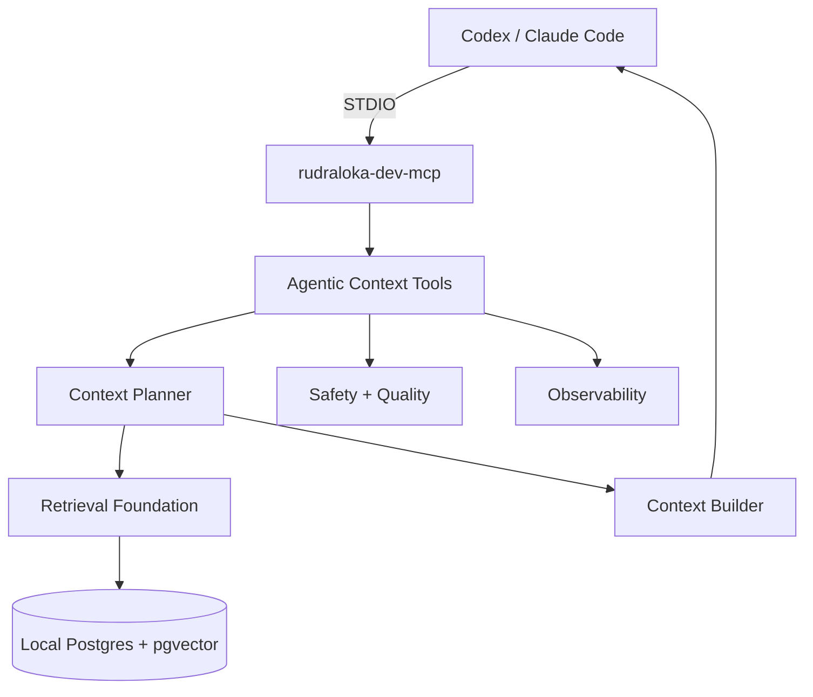

# Local MCP Agentic Context Engineering + RAG Design Spec

## Status

Status: Draft design/spec with Phase 2 local runtime foundation, Milestone 1 DB foundation, Milestone 2 scanner/chunking preview tools, Milestone 3 mock embedding storage/indexing, Milestone 4 hybrid retrieval/context builder, Milestone 5 deterministic agentic context planner, and final local hardening added.

RAG retrieval is implemented for local mock-index search only. The agentic planner is implemented as deterministic advisory planning only. Final hardening keeps the same MCP tool names and adds bounded diagnostics, retrieval quality reports, safe observability summaries, conservative hash-based indexing pre-skips, and operation/security docs.

This document is a reviewable design specification. Phase 2 added local Docker Compose Postgres + pgvector runtime configuration. Milestone 1 adds the direct SQL local AI schema migration and safe MCP DB management tools. Milestone 2 adds a safe indexing policy, safe scanner, structure-aware chunking, and read-only preview/eval MCP tools. Milestone 3 adds an `EmbeddingProvider` interface, deterministic `MockEmbeddingProvider`, pgvector storage writes, manual indexing, safe index status, and a conservative mock-specific HNSW migration file. Milestone 4 adds local hybrid retrieval, Postgres full-text search, metadata filters, heuristic reranking, bounded context building, and retrieval/context evals. Milestone 5 adds `plan_project_context`, deterministic task classification, context strategy selection, planner evals, and planner documentation. Final hardening improves diagnostics and operations without changing the public tool surface. It does not add real embedding providers, API keys, environment files, paid provider usage, watch mode, production RAG, model reranking, automatic multi-step tool execution, command execution, file patching, or source-file mutation through planner/context tools.

## Goal

The goal is to give Codex and Claude Code a safe, searchable, context-aware project knowledge layer for local Rudraloka development.

RAG is the retrieval foundation. It finds relevant project knowledge from approved docs and source files.

Agentic context engineering is the orchestration layer. It decides when retrieval is needed, which sources matter, which tools should be used for live state, and how much context should be returned.

This subsystem is for local developer productivity only. It is not customer-facing Rudraloka AI, not production product RAG, and not a public MCP service.

## Non-goals

- No production/customer RAG yet.
- No product recommendation agent yet.
- No public ChatGPT MCP exposure.
- No arbitrary file indexing.
- No secret indexing.
- No file mutation through RAG/context tools.
- No RAG implementation beyond the local mock retrieval, context, planner, eval, observability, and hardening layer described here.
- No real embeddings or external-model planner.
- No arbitrary SQL MCP tool.
- No new search migrations or runtime tuning beyond the already approved local mock retrieval path.
- No embedding API keys, `.env` files, or credential setup.
- No paid embedding provider usage now.

## Finalized Implementation Decisions

These decisions are locked for the next implementation plan unless the user explicitly changes them later.

### Decision 1: Docker Compose for local pgvector

Selected option: use Docker Compose for the local Postgres + pgvector runtime.

Why chosen:

- Docker Compose gives reproducible local infrastructure.
- It matches future Docker and Kubernetes learning.
- It avoids machine-specific Postgres setup.
- It keeps local pgvector clearly separate from production infrastructure.

Tradeoffs:

- Requires Docker runtime on the developer machine.
- Adds one local service to start, stop, inspect, and reset.
- Database volume behavior must be documented so local state is understandable.

Implementation implications:

- Phase 2 creates the local Compose setup, not application runtime code.
- The Compose folder is `infra/local-dev/postgres-pgvector/`.
- The service and container name are `rudraloka-local-pgvector`.
- The named volume is `rudraloka-local-pgvector-data`.
- The database is `rudraloka_local_ai`.
- The user is `rudraloka_local`.
- The host port is `5433`.
- Do not add credentials through `.env` files in this design step.

Future revisit conditions:

- Docker is too heavy for the local workflow.
- A later production-like environment needs a different runtime.
- Local reset/backup behavior becomes difficult to operate.

```txt
rudraloka-dev-mcp
   |
   v
Docker Compose network
   |
   v
Postgres + pgvector
   |
   v
rag_documents / rag_chunks / rag_embeddings
```

This diagram shows the approved local storage direction. MCP talks to the local database service over the Compose network once implementation begins.

### Decision 2: EmbeddingProvider interface + mock first

Selected option: create an `EmbeddingProvider` interface and implement a `MockEmbeddingProvider` first. A real provider comes later.

Why chosen:

- The interface avoids provider lock-in.
- The mock provider lets scanner, chunker, schema, insert/search, and eval plumbing be tested without API keys or cost.
- The user does not want paid provider usage now.

Tradeoffs:

- Mock embeddings are not semantically meaningful.
- Retrieval quality evals must distinguish pipeline tests from semantic-quality tests.
- A later real provider may require re-embedding and dimension changes.

Implementation implications:

- Build provider boundaries before choosing a real model.
- Keep mock dimensions explicit and stable.
- Do not add embedding API keys or `.env` files.

Future revisit conditions:

- The pipeline is stable and semantic retrieval quality needs real measurement.
- A local embedding model becomes easy and low-cost.
- The user approves hosted provider usage later.

```txt
Chunk text
   |
   v
EmbeddingProvider interface
   |-- MockEmbeddingProvider now
   |-- LocalEmbeddingProvider later
   `-- HostedEmbeddingProvider later
   |
   v
embedding vector
```

This diagram shows why provider boundaries come before provider choice.

### Decision 3: HNSW with memory-optimized defaults

Selected option: use HNSW as the target pgvector index type.

Why chosen:

- HNSW has strong query speed and recall behavior.
- It is a good default target for high-quality semantic search.

Tradeoffs:

- HNSW generally uses more memory than IVFFlat.
- HNSW index build cost can be higher.
- Local development defaults must be conservative and configurable.

Implementation implications:

- Do not hardcode aggressive HNSW parameters.
- First implementation may allow exact vector search fallback for tiny indexes.
- Document future tuning before increasing memory-heavy settings.

Future revisit conditions:

- Local memory usage is too high.
- Index build time becomes painful.
- The index remains tiny enough that exact search is simpler.
- IVFFlat becomes more appropriate for local constraints.

### Decision 4: Structure-aware chunking with fallback

Selected option: use structure-aware chunking first, with fallback chunking when structure is unavailable.

Why chosen:

- Markdown headings preserve document meaning.
- TypeScript structure preserves code meaning.
- Good chunking improves retrieval quality more than naive fixed windows.

Tradeoffs:

- More implementation complexity than simple text splitting.
- Fallback logic must be reliable when parsing fails.
- Chunk sizes and overlap still need tuning.

Implementation implications:

- Markdown should use heading-aware chunks.
- TypeScript should use AST-based chunks.
- Fallback chunking should use medium-size windows with overlap.

Future revisit conditions:

- AST parsing is too slow or brittle.
- Eval results show chunks are too small, too large, or missing context.

### Decision 5: Exclude archive docs by default

Selected option: exclude `docs/99-archive/` from normal indexing by default.

Why chosen:

- Archived docs should not pollute current context.
- Current source-of-truth docs should rank higher than historical notes.

Tradeoffs:

- Historical questions may need explicit archive search later.
- Archive exclusion can hide useful migration context unless requested.

Implementation implications:

- Scanner should report archive skips.
- Add an `includeArchived` option later for explicit historical retrieval.
- Archived content can still become searchable explicitly later.

Future revisit conditions:

- The user asks for historical search.
- Eval cases require archived context.

### Decision 6: AST-based TypeScript parsing

Selected option: use AST-based parsing for TypeScript chunking.

Why chosen:

- AST parsing is better than regex for understanding code structure.
- It helps chunk functions, classes, exports, and types accurately.

Tradeoffs:

- More complexity and dependency/design work.
- Parser choice and package details remain open.
- Parsing can fail on syntax or config edge cases.

Implementation implications:

- TypeScript chunking should fail gracefully to fallback text chunking.
- Parser failures should be logged safely as metadata, not file contents.

Future revisit conditions:

- AST parsing adds too much overhead.
- Simple source files do better with lighter heuristics.

### Decision 7: Direct SQL with `pg` first

Selected option: use direct SQL with `pg` first.

Why chosen:

- Direct SQL makes pgvector and full-text search queries explicit.
- It is better for learning Postgres and pgvector internals.
- It avoids adding an ORM before the vector/search shape is proven.

Tradeoffs:

- More manual query and migration discipline.
- Less type-safe than a mature ORM layer.

Implementation implications:

- SQL should be small, explicit, parameterized, and reviewed.
- Prisma may be considered later if schema complexity grows and vector workflows remain manageable.
- Milestone 1 uses direct SQL with `pg` for fixed health checks, migration status, and approved migration execution.

Future revisit conditions:

- Query surface grows too large for direct SQL.
- Schema relationships become cumbersome.
- Prisma or another query layer supports the needed vector workflows cleanly.

### Decision 8: Manual indexing first, optional watch mode later

Selected option: manual indexing first.

Why chosen:

- Manual indexing is safer and predictable.
- It avoids surprise background reads or writes.
- It makes eval and observability behavior easier to understand early.

Tradeoffs:

- The index can become stale until manually refreshed.
- Developer workflow has one extra explicit step.

Implementation implications:

- `index_project_knowledge` should be user-triggered.
- Final hardening adds conservative file-hash pre-skips for unchanged files without schema changes.
- Watch mode is a future option, not the current implementation decision.

Future revisit conditions:

- Manual refresh becomes tedious.
- Eval coverage and observability are stable enough to trust optimized refresh.

### Decision 9: Heuristic reranking first

Selected option: heuristic reranking first.

Why chosen:

- Heuristic reranking is transparent and free.
- It fits the user's constraint to avoid paid provider usage now.

Tradeoffs:

- Heuristics may miss nuanced semantic relevance.
- Model reranking can be stronger, but it adds cost and provider complexity.

Implementation implications:

- Use source priority, keyword match, archive penalty, security-doc boost, and exact identifier boost.
- Model reranking comes later only if it is very low cost and demonstrably useful.

Future revisit conditions:

- Retrieval evals show heuristic ranking is insufficient.
- A low-cost local or hosted reranker becomes practical.

### Decision 10: Postgres full-text search alongside pgvector

Selected option: use Postgres full-text search alongside pgvector.

Why chosen:

- Vector search handles semantic similarity.
- Full-text search handles exact identifiers and code terms.
- Hybrid retrieval fits codebases better than vector-only search.

Tradeoffs:

- More query complexity.
- Ranking must merge two different score types.

Implementation implications:

- Store searchable text fields suitable for Postgres full-text search.
- Merge semantic and keyword candidates before heuristic reranking.
- Keep exact identifier boosts visible in evals.

Future revisit conditions:

- Postgres full-text search is not enough for code identifiers.
- A dedicated keyword/BM25 engine becomes worth the added complexity.

```txt
Query
   |
   v
pgvector semantic search
   +
Postgres full-text search
   |
   v
merge candidates
   |
   v
heuristic reranker
   |
   v
context builder
```

This diagram shows the locked hybrid retrieval path: semantic and keyword search run side by side, then a free heuristic reranker prepares candidates for the context builder.

## Phase 2 Implementation Note

Docker Compose pgvector runtime is the first implementation phase.

Phase 2 creates only the local database runtime:

- Compose folder: `infra/local-dev/postgres-pgvector/`
- Service/container: `rudraloka-local-pgvector`
- Persistent volume: `rudraloka-local-pgvector-data`
- Database: `rudraloka_local_ai`
- User: `rudraloka_local`
- Host port: `5433`
- pgvector extension enabled by init SQL

Phase 2 does not create:

- RAG schema tables.
- Embeddings.
- HNSW, IVFFlat, or other vector indexes.
- MCP database connection code.
- RAG/context MCP tools.
- Paid provider integration.

```txt
Phase 2
   |
   v
Docker Compose
   |
   v
Postgres + pgvector
   |
   v
Milestone 1 schema/migrations
```

This diagram shows the boundary. Phase 2 prepares storage capability only. HNSW remains the selected future vector index, but it should not be created until chunks and embeddings exist and local memory defaults are reviewed.

The runtime is intentionally low-memory and low-cost: no embedding provider runs, no vectors are generated, no vector index is built, and no background indexing is started.

## Milestone 1 Implementation Note

Milestone 1 creates the local AI DB schema and safe MCP DB tools.

- Migration folder: `infra/db/local-ai/migrations/`
- Migration: `001_create_local_ai_schema.sql`
- Postgres schema: `local_ai`
- MCP tools:
  - `check_local_ai_db`
  - `get_local_ai_migration_status`
  - `run_local_ai_migrations`

```txt
rudraloka-dev-mcp
   |
   v
safe DB tools
   |
   v
Migration runner
   |
   v
infra/db/local-ai/migrations/*.sql
   |
   v
local_ai schema
```

This diagram shows the Milestone 1 boundary. MCP can check DB health, inspect migration metadata, and run reviewed migrations with exact approval text. It still cannot run arbitrary SQL or index project knowledge.

## Milestone 2 Implementation Note

Milestone 2 creates the scanner and chunking preview foundation.

- MCP source folder: `mcp/rudraloka-dev-mcp/src/knowledge/`
- Indexing policy: approved docs, skills, root policy files, and MCP TypeScript source only
- Scanner: metadata and hashes only, no file contents in scan reports
- Chunkers: Markdown heading-aware, TypeScript AST-based, and fallback text windows
- MCP tools:
  - `preview_project_knowledge_scan`
  - `preview_project_chunks`
  - `run_knowledge_pipeline_evals`

```txt
approved project files
   |
   v
indexing policy
   |
   v
safe scanner
   |
   v
structure-aware chunkers
   |
   v
bounded preview output only
```

This diagram shows the Milestone 2 boundary. The scanner can read approved files to compute hashes and chunk previews, but it does not store chunks in Postgres, create embeddings, run vector search, or retrieve context for answers.

Milestone 2 safety limits are centralized in the MCP config:

- `MAX_KNOWLEDGE_SCAN_FILES`
- `MAX_KNOWLEDGE_FILE_BYTES`
- `MAX_KNOWLEDGE_CHUNKS_PER_FILE`
- `MAX_CHUNK_PREVIEW_CHARS`
- `DEFAULT_FALLBACK_CHUNK_CHARS`
- `DEFAULT_FALLBACK_CHUNK_OVERLAP_CHARS`

These limits prevent excessive local memory use, accidental huge MCP responses, and context-window flooding while the pipeline is still in preview mode.

## Milestone 3 Implementation Note

Milestone 3 proves the indexing and storage pipeline with mock embeddings.

- Embedding provider boundary: `EmbeddingProvider`.
- Current provider: deterministic `MockEmbeddingProvider`.
- Mock dimension: `64`.
- Mock model/version: `rudraloka-mock-embedding` / `mock-embedding-v1`.
- Migration: `002_add_mock_embedding_hnsw_index.sql`.
- MCP tools:
  - `index_project_knowledge`
  - `get_project_knowledge_index_status`

```txt
approved files
   |
   v
scanner + chunker
   |
   v
MockEmbeddingProvider
   |
   v
local_ai.rag_documents / rag_chunks / rag_embeddings
   |
   v
safe status summaries
```

This diagram shows the Milestone 3 boundary. The system can manually build a local mock index, but it still cannot search, retrieve, rank, or build context from that index.

The mock provider is intentionally not semantic. It lets the project validate file policy, chunking, vector storage, idempotent indexing, migration readiness, and eval guardrails without API keys or paid usage. Semantic retrieval quality comes later after a real provider is approved and Milestone 4 retrieval work begins.

The HNSW index is partial and mock-specific:

- `embedding_model = 'rudraloka-mock-embedding'`
- `embedding_version = 'mock-embedding-v1'`
- `embedding_dimension = 64`
- `m = 8`
- `ef_construction = 32`

Those are conservative local-dev defaults, not production tuning. Migration `002` is defensive: it fails closed if existing non-null embeddings cannot safely become `vector(64)`, and it does not truncate, coerce, drop tables, or run automatically.

## Milestone 4 Implementation Note

Milestone 4 adds search and context building on top of the existing manual mock index.

- Retrieval store: fixed, parameterized SQL only.
- Migration: `003_add_project_knowledge_retrieval_search.sql`.
- MCP tools:
  - `search_project_knowledge`
  - `get_relevant_context`
  - `run_project_rag_evals`

```txt
query or task
   |
   v
MockEmbeddingProvider + Postgres full-text query
   |
   v
pgvector candidates + full-text candidates
   |
   v
metadata filters + heuristic reranking
   |
   v
bounded search results or compact context
```

This diagram shows the Milestone 4 boundary. Retrieval can search the approved local knowledge index and build compact context, but it does not run migrations, index files automatically, call real providers, mutate source files, or plan tasks.

Milestone 4 always uses the latest successful completed mock index run. If no completed mock index exists, retrieval tools return a safe index-not-ready response instead of guessing an index version.

Mock embeddings remain non-semantic. Retrieval evals therefore focus on exact names, full-text search, metadata boosts, source expectations, forbidden-source exclusion, and context budgets.

## Why Not Naive RAG

Naive RAG usually looks like this:

```txt
documents
   |
   v
random chunks
   |
   v
embeddings
   |
   v
topK vector search
   |
   v
prompt stuffing
```

This means the system chops documents into pieces, embeds them, retrieves the nearest vectors, and pushes those chunks into the prompt.

That is not enough for a codebase like Rudraloka.

Naive RAG fails because:

- Bad chunks split concepts in the wrong places.
- Missing metadata makes sources hard to trace or reindex.
- Missing access policy can copy secrets into the index.
- Pure vector search is weak for exact identifiers.
- No hybrid search means names like `run_mcp_security_evals` can be missed.
- No evals means retrieval regressions are invisible.
- No observability makes bad answers hard to debug.
- No context budgeting can stuff too much noise into the model.
- No source prioritization can rank archived or stale docs too high.

The safe version is not "embed everything." The safe version is "index only approved knowledge, preserve source metadata, evaluate retrieval, and plan context deliberately."

## Modern Architecture: Agentic Context Engineering

Context engineering is the umbrella. It includes retrieval, exact file reads, tool results, security policy, architecture decisions, and user intent.

RAG is the retrieval layer inside that umbrella. RAG is useful for stable project knowledge such as docs, skills, security policies, and source structure.

The context planner decides what context is needed. It should know when to retrieve project knowledge, when to read exact files, when to include security or architecture docs, when to inspect logs/evals, and when to ask the user for a decision.

Tools/API calls are used for live state. Retrieval is used for stable project knowledge. Evals verify retrieval and planner behavior. Observability helps debug failures.

```txt
Task from user
   |
   v
Context Planner
   |
   v
Context Strategy
   |-- retrieve project knowledge
   |-- read exact files when needed
   |-- include security/architecture rules
   |-- inspect logs/evals when needed
   `-- ask user for decision when required
   |
   v
Context Builder
   |
   v
Codex / Claude response or implementation plan
```

The planner is the difference between "search and stuff" and "choose the right evidence for this task."

## Selected Architecture Diagram

```txt
Codex / Claude Code
   |
   | STDIO
   v
rudraloka-dev-mcp
   |
   v
Agentic Context Tools
   |-- plan_project_context
   |-- index_project_knowledge
   |-- search_project_knowledge
   |-- get_relevant_context
   `-- run_project_rag_evals

Context Planner
   |-- classifies the task
   |-- decides what context is needed
   |-- chooses retrieval strategy
   |-- includes security/architecture docs when relevant
   `-- avoids unnecessary context

Retrieval Foundation
   |-- indexing policy
   |-- scanner
   |-- chunker
   |-- embedding provider
   |-- pgvector store
   |-- Postgres full-text search
   |-- metadata filters
   |-- heuristic reranking
   `-- source-aware context builder

Storage
   `-- local Postgres + pgvector

Safety + Quality
   |-- no secret indexing
   |-- no source-code mutation through RAG tools
   |-- retrieval evals
   |-- MCP security evals
   `-- logs/audit summaries

Observability
   |-- traceId/spanId
   |-- indexing logs
   |-- retrieval logs
   |-- planner logs
   `-- eval reports
```

This diagram separates the MCP entrypoint, the context tools, the planner, the retrieval foundation, storage, safety checks, and observability.



The Mermaid view shows the same architecture as a compact loop: the assistant calls MCP, MCP plans and retrieves context, the context builder returns compact evidence, and safety/observability surround the flow.

## Data Flow

```txt
Allowed project files
   |
   v
Indexing policy
   |
   v
Scanner
   |
   v
Chunker
   |
   v
Metadata builder
   |
   v
Embedding provider
   |
   v
Postgres + pgvector
   |
   v
Retriever
   |
   v
Context planner / context builder
   |
   v
Codex / Claude
```

Allowed project files are the only files the system may consider. The first safety question is not "can this be embedded?" but "should an AI assistant ever see this?"

The indexing policy is the security gate. It applies path, extension, size, archive, and secret rules before content is scanned.

The scanner walks only approved folders, computes hashes, identifies source type, and records skip reasons.

The chunker breaks documents and code into useful pieces. Good chunks preserve meaning, headings, symbols, and nearby context.

The metadata builder attaches source paths, hashes, heading paths, symbols, token estimates, index versions, and embedding model details.

The embedding provider turns chunk text into vectors. The provider is abstract so hosted, local, and mock providers can be swapped later.

Postgres + pgvector stores documents, chunks, embeddings, index runs, and retrieval eval results. Postgres full-text search supports exact keyword and identifier matching alongside vector search.

The retriever combines semantic search, Postgres full-text search, metadata filters, and heuristic reranking.

The context planner and context builder decide what to return to Codex or Claude, avoid unnecessary context, and include source labels.

## Layer 1: Indexing Policy

Indexing policy is the security gate for the knowledge index.

The rule is simple: never index what AI should never see.

Allowed sources:

- `AGENTS.md`
- `CLAUDE.md`
- `.agents/skills/**/SKILL.md`
- `docs/**/*.md`
- `mcp/rudraloka-dev-mcp/src/**/*.ts`

Blocked sources:

- `.env`
- `.env.*`
- `.npmrc`
- `.git/`
- `node_modules/`
- `dist/`
- `build/`
- `coverage/`
- `.mcp-local/`
- private keys
- tokens
- credentials
- unknown extensions
- large files

Archived docs under `docs/99-archive/` are excluded by default. Archived docs can be useful for historical questions, but they should not outrank current source-of-truth docs. A future explicit `includeArchived` option can make them searchable when the user asks for historical context.

The indexing policy should reuse or mirror the existing MCP path policy where possible. The MCP security policy is the guiding reference: [MCP Security Policy](../05-security/mcp-security-policy.md).

## Layer 2: File Scanner

The scanner is responsible for safe folder walking and scan reports.

Status: implemented in Milestone 2 as a read-only preview scanner.

Scanner responsibilities:

- Walk only allowlisted roots.
- Apply blocked directory and blocked file rules.
- Apply extension and size limits.
- Compute file hashes for stale detection.
- Detect source type such as `project-policy`, `skill`, `mcp-doc`, `ai-infra-doc`, `security-doc`, `runbook`, or `typescript-source`.
- Record skip reasons without reading blocked content.
- Make indexing idempotent by recognizing unchanged files.
- Produce a scan report that can be logged safely.

Example scan report:

```json
{
  "filesScanned": 40,
  "filesAllowed": 32,
  "filesSkipped": 8,
  "skipReasons": {
    "blockedDirectory": 3,
    "unsupportedExtension": 2,
    "tooLarge": 1,
    "archiveExcluded": 2
  }
}
```

The scan report should help debugging without exposing file contents.

## Layer 3: Chunking Engine

Chunking means breaking larger files into meaningful smaller pieces.

Status: implemented in Milestone 2 as read-only chunk preview logic. Chunks are not stored in the database yet.

Bad chunks split meaning. Good chunks preserve enough local context that a retrieved chunk makes sense by itself.

Markdown should use heading-aware chunks:

```txt
Markdown file
   |
   v
Heading sections
   |
   v
Chunks with headingPath metadata
```

The explanation: a Markdown section usually has a title and a focused idea. Storing the heading path helps the retriever cite and group related chunks.

TypeScript should use AST-based symbol-aware chunks:

```txt
TypeScript file
   |
   v
AST exports/functions/classes
   |
   v
Chunks with symbol metadata
```

The explanation: code questions often ask about a function, class, exported type, or policy helper. AST parsing is more reliable than regex for finding those structures. Symbol metadata helps exact and semantic retrieval work together.

Fallback chunking can use token or character windows with overlap when a file has no reliable structure.

Chunk size tradeoffs:

- Smaller chunks improve precision but can lose context.
- Larger chunks preserve context but can waste prompt budget.
- Too many chunks increase index and retrieval cost.

Chunk overlap tradeoffs:

- Some overlap prevents boundary loss.
- Too much overlap creates duplicate retrieval results.
- Overlap should be lower for heading-aware docs and higher for unstructured text.

Current docs should have higher priority than archived docs. Archived docs are excluded by default and can be searched later only through an explicit historical/archived mode.

Good chunk example:

```txt
File: docs/03-mcp/controlled-write-workflow.md
Heading: Exact Approval Text
Body: Patch application requires APPLY_PATCH:<patchId>...
```

Bad chunk example:

```txt
...requires APPLY_PATCH:<patchId>

## Exact Replacement Patching

Patch proposals use exact text...
```

The bad example is not always terrible, but it mixes two concepts. Better chunk boundaries make retrieval easier to evaluate.

## Layer 4: Metadata Model

Proposed metadata:

- `chunkId`
- `documentId`
- `filePath`
- `sourceType`
- `headingPath`
- `symbolName`
- `chunkIndex`
- `contentHash`
- `fileHash`
- `chunkingStrategy`
- `tokenEstimate`
- `indexVersion`
- `createdAt`
- `updatedAt`
- `embeddingModel`
- `embeddingDimension`
- `embeddingVersion`

Metadata matters because it supports:

- Traceability from answer back to source.
- Reindexing only changed files or chunks.
- Debugging stale or low-quality chunks.
- Stale chunk detection through hashes.
- Retrieval evaluation against expected sources.
- Source citation in context returned to Codex/Claude.
- Filtering by source type, current-vs-archive status, or security relevance.

Without metadata, retrieval becomes a pile of text. With metadata, retrieval becomes explainable project memory.

## Layer 5: Embedding Provider

Embeddings are meaning fingerprints. They turn text into vectors so semantically similar chunks can be found even when they use different words.

The provider should be an interface, not a hardcoded implementation.

Approved provider path:

- `MockEmbeddingProvider` first for pipeline tests and eval plumbing.
- `LocalEmbeddingProvider` later if local model setup becomes practical.
- `HostedEmbeddingProvider` later only if the user approves provider usage and cost.

Why not hardcode the provider:

- Hosted and local providers have different cost, latency, privacy, and setup tradeoffs.
- Tests need deterministic behavior without network calls.
- Embedding models can change dimensions.
- Re-embedding should be explicit when model versions change.
- The user does not want paid provider usage now.

Provider concerns:

- Embedding model versioning.
- Dimension consistency.
- Batching.
- Rate limits.
- Retry/backoff later.
- Cost tracking later.

Mock embeddings are not semantically meaningful. Early evals must separate pipeline correctness from semantic retrieval quality.

Remaining future decision:

- Exact mock embedding dimension.
- When to introduce a real local or hosted provider.
- Which real embedding model to use later.

## Layer 6: pgvector Store

Local Postgres + pgvector is the target storage because it gives Rudraloka a realistic vector database foundation while staying local to development. The approved local runtime is Docker Compose.

Implemented Milestone 1 tables:

- `rag_index_runs`
- `rag_documents`
- `rag_chunks`
- `rag_embeddings`
- `rag_retrieval_evals`

Conceptual schema fields:

```txt
rag_index_runs
  id
  indexVersion
  status
  startedAt
  completedAt
  filesScanned
  filesIndexed
  chunksCreated
  chunksEmbedded
  skippedSummary

rag_documents
  documentId
  filePath
  sourceType
  fileHash
  indexVersion
  isArchived
  createdAt
  updatedAt

rag_chunks
  chunkId
  documentId
  chunkIndex
  content
  contentHash
  headingPath
  symbolName
  chunkingStrategy
  tokenEstimate
  createdAt
  updatedAt

rag_embeddings
  chunkId
  embedding
  embeddingModel
  embeddingDimension
  embeddingVersion
  createdAt

rag_retrieval_evals
  evalId
  suiteName
  query
  expectedSources
  actualSources
  status
  metrics
  createdAt
```

These tables are now created by the first local AI DB migration. They are storage foundation only. Later milestones build scanner/chunking previews, embedding provider, insert/search code, hybrid retrieval, context builder, planner behavior, and eval implementation on top of this schema.

Vector index decision:

- HNSW is selected for the first vector index because of its strong query speed/recall behavior.
- HNSW generally uses more memory than IVFFlat, so local defaults must be conservative and configurable.
- IVFFlat: faster/lower memory build, but recall/performance tradeoff and more tuning.

Do not hardcode aggressive HNSW parameters. For tiny local indexes, the first implementation may allow exact search fallback before HNSW is worth building.

Local dev pgvector is for repository context. Future production pgvector would need separate access control, tenant boundaries, backup/restore, data deletion, and operational monitoring.

Migrations are now versioned under `infra/db/local-ai/migrations/`. The approved DB access direction is direct SQL with `pg` first; Prisma may be considered later if the schema grows and vector workflows remain manageable.

## Layer 7: Hybrid Retrieval

Vector search finds semantic meaning.

Postgres full-text search finds exact terms.

Codebases need both because exact identifiers matter. A semantic embedding may understand "approval workflow," but exact search is better for:

- `run_mcp_security_evals`
- `APPLY_PATCH`
- `AGENTS.md`
- `RUDRALOKA_PROJECT_ROOT`

Hybrid retrieval uses pgvector and Postgres full-text search together:

```txt
Query
   |
   v
pgvector semantic search
   +
Postgres full-text search
   |
   v
Merge candidates
   |
   v
Metadata filters
   |
   v
Heuristic reranker
   |
   v
Top context candidates
```

The explanation: vector retrieval catches conceptual matches, full-text search catches exact names, metadata filters remove unsafe or irrelevant sources, and the heuristic reranker picks the best compact set.

Metadata filters should support source type, path prefix, current-vs-archive status, and security relevance.

Archived docs are excluded by default unless the query explicitly asks for historical context through a future `includeArchived` option.

Exact keyword matches should receive a boost for code identifiers, tool names, environment variable names, and approval tokens.

Heuristic reranking is the first reranking layer. It should use source priority, keyword match, archive exclusion/penalty behavior, security-doc boost, and exact identifier boost. Model reranking is deferred unless it becomes very low cost and demonstrably useful.

## Layer 8: Context Planner

The context planner is the Option C layer.

It classifies the task type, selects the context strategy, and decides when to retrieve, read exact files, inspect logs/evals, or ask the user for a decision.

Status: implemented in Milestone 5 as a deterministic advisory planner.

Task types:

- `architecture-decision`.
- `implementation-change`.
- `debugging`.
- `security-review`.
- `documentation`.
- `ai-infra-design`.
- `mcp-context-tooling`.
- `general-project-context`.

Context strategies:

- `architecture-options-first`.
- `security-policy-first`.
- `implementation-context`.
- `debugging-evidence`.
- `docs-learning-update`.
- `ai-infra-context`.
- `general-context`.

Planner responsibilities:

- Include security docs for risky MCP, indexing, or tool changes.
- Include architecture decisions for design choices.
- Include implementation files when code behavior is being discussed.
- Include eval docs and reports when safety or retrieval quality is involved.
- Avoid retrieving too much.
- Ask the user for a decision when the task is an architecture choice.
- Never mutate files.
- Never call the database, filesystem, retrieval tools, model APIs, command tools, migration tools, indexing tools, or mutation tools.
- Recommend tools only from an explicit safe allowlist.
- Keep recommended queries, sources, tools, warnings, and next steps capped.
- Keep `get_relevant_context` separate for Milestone 5; the planner remains advisory and separately testable.

Example task:

```txt
Add local pgvector indexing safely.
```

Planner includes:

- MCP security policy.
- AI infra roadmap.
- Path-policy source.
- Eval harness source.
- Local MCP architecture docs.

## Layer 9: Context Builder

The context builder creates the compact final context returned to Codex or Claude.

It should not dump raw topK blindly.

Context builder responsibilities:

- Rank and deduplicate retrieved chunks.
- Group by source.
- Apply context budget.
- Include warnings.
- Prioritize security docs for risky tasks.
- Include source paths and short previews.
- Avoid including archived docs unless needed.
- Preserve enough metadata for source citation.

```txt
Retrieved chunks
   |
   v
Rank + deduplicate
   |
   v
Apply context budget
   |
   v
Add source labels
   |
   v
Return compact context to Codex/Claude
```

The explanation: retrieval finds candidates, but the builder turns candidates into a readable packet of evidence.

## Layer 10: Eval Harness

There are three related eval categories:

- MCP security evals: deterministic checks that local tools fail closed.
- RAG retrieval evals: checks that queries retrieve expected safe sources.
- Agentic workflow evals: checks that the planner chooses the right context strategy.

Example retrieval evals:

- Patch approval question should retrieve controlled-write docs and `patch-service.ts`.
- No secret indexing question should retrieve security policy and `AGENTS.md`.
- Architecture decisions question should retrieve architecture-decision skill and `AGENTS.md`.
- Claude compatibility question should retrieve `CLAUDE.md` and the runbook.

Metrics:

- Expected source found.
- TopK hit rate.
- No forbidden source returned.
- Retrieval latency.
- Context size.
- Planner strategy correctness.

`run_project_rag_evals` is the local retrieval quality report surface. Its `qualityReport` summarizes hits, misses, forbidden hits, safe skips, context budget checks, and planner totals without returning chunk bodies.

Expected sanitization or denial should count as a pass when the safe behavior is to omit unsafe context.

## Layer 11: Observability

Observability should make indexing, retrieval, planning, and eval behavior debuggable without exposing sensitive payloads.

Log categories:

- Indexing logs.
- Retrieval logs.
- Planner logs.
- Eval logs.

Reuse `traceId` and `spanId` patterns from the current MCP observability layer.

Do not log:

- Full file contents.
- Full embeddings in normal logs.
- Secrets.
- Command output.
- Prompt bodies that contain large retrieved context.

Safe log fields:

- Counts.
- Durations.
- Hashes.
- Source counts and capped safe path examples only when explicitly returned by diagnostic tools.
- Chunk counts.
- Provider name/version.
- Index version.
- Eval status.

```txt
Index / Search / Plan Operation
   |
   v
traceId + spanId
   |
   v
safe app log
   |
   v
eval/audit report
   |
   v
safe summary tools
```

The explanation: logs should help answer "what happened?" without becoming another copy of the indexed corpus.

OpenTelemetry can come later when local JSONL summaries are no longer enough.

## Layer 12: MCP Tool Contracts

Milestone 2 implements read-only preview/eval contracts. Milestone 3 implements manual mock indexing and safe index status. Milestone 4 implements search, context, and RAG eval contracts. Milestone 5 implements the advisory planner contract.

Implemented Milestone 2 tools:

- `preview_project_knowledge_scan`: returns safe scanner metadata and hashes only.
- `preview_project_chunks`: returns bounded chunk previews for one indexable file.
- `run_knowledge_pipeline_evals`: checks the scanner/chunker policy and safety behavior.

These preview tools do not write to source files, write to the local AI database, create embeddings, perform vector search, run full-text search, retrieve context, or call a model provider.

Implemented Milestone 3 tools:

- `index_project_knowledge`: manually writes approved documents, chunks, and mock embeddings to the local AI DB index.
- `get_project_knowledge_index_status`: returns safe local index counts and run metadata only.

Tool contracts:

### 1. `plan_project_context`

Status: implemented in Milestone 5 as deterministic advisory planning only.

Input:

```json
{
  "task": "...",
  "mode": "architecture|implementation|debugging|security-review|docs|ai-infra|auto"
}
```

Output:

```json
{
  "taskType": "...",
  "strategy": "...",
  "recommendedQueries": [],
  "recommendedSources": [],
  "recommendedTools": [],
  "needsUserDecision": false,
  "includeSecurityContext": false,
  "includeArchitectureContext": false,
  "warnings": [],
  "nextSteps": []
}
```

The planner does not call the database, filesystem, retrieval tools, model APIs, command tools, migration tools, indexing tools, or mutation tools. It also does not integrate into `get_relevant_context` in Milestone 5.

### 2. `index_project_knowledge`

Status: implemented in Milestone 3 for manual mock indexing only.

Input:

```json
{
  "scope": "docs-and-mcp",
  "includeArchived": false,
  "forceReindex": false,
  "approvalText": ""
}
```

Output:

```json
{
  "status": "completed",
  "indexVersion": "...",
  "filesScanned": 0,
  "filesIndexed": 0,
  "filesSkipped": 0,
  "chunksCreated": 0,
  "chunksEmbedded": 0,
  "skippedExamples": [],
  "errorExamples": []
}
```

### 3. `search_project_knowledge`

Input:

```json
{
  "query": "...",
  "topK": 5,
  "includeArchived": false
}
```

Output:

```json
{
  "query": "...",
  "results": [
    {
      "filePath": "...",
      "score": 0.0,
      "sourceType": "...",
      "headingPath": "...",
      "preview": "..."
    }
  ]
}
```

### 4. `get_relevant_context`

Input:

```json
{
  "task": "...",
  "maxChunks": 8,
  "includeSecurityContext": true
}
```

Output:

```json
{
  "task": "...",
  "context": "...",
  "sources": []
}
```

### 5. `run_project_rag_evals`

Input:

```json
{}
```

Output:

```json
{
  "suiteName": "project-rag-evals",
  "status": "passed",
  "total": 0,
  "passed": 0,
  "failed": 0
}
```

These tools are read/context tools.

They must not mutate project source files.

`index_project_knowledge` mutates only the local knowledge index, not source code.

All tools must respect the existing MCP security policy.

## Security Requirements

- No secret indexing.
- No arbitrary paths.
- No `.mcp-local` exposure through summaries.
- No generated folders.
- No command execution from RAG/context tools.
- No project file mutation from RAG/context tools.
- Safe summaries only.
- Evals before broader indexing.
- Reuse existing path-policy where possible.
- Use least privilege.
- Fail closed.
- Do not expose local dev MCP publicly.
- Do not index archived docs by default unless the behavior is explicitly reviewed.

## Failure Modes

Database unavailable:

Return a safe error. Do not fall back to indexing files into model context.

Embedding provider unavailable:

Return a safe error or use a mock provider only in explicit test/eval mode.

Dimension mismatch:

Reject the index operation or retrieval query. Embeddings with different dimensions must not be mixed.

Stale index:

Mark stale documents and prefer exact safe reads for high-risk tasks until reindexing succeeds.

Corrupted index run:

Fail closed, keep the previous good index if available, and emit a safe eval/report.

File changed during indexing:

Detect via file hash and re-scan/re-chunk before embedding.

Too many chunks:

Stop or batch safely. Return a scan report that explains limits.

Retrieval returns irrelevant chunks:

Eval should fail. Planner should ask for exact file reads or user clarification when confidence is low.

Context too large:

Context builder should trim, deduplicate, and preserve the highest-priority security/architecture sources.

Eval fails:

Do not expand tool capabilities until the failure is understood.

Planner chooses unsafe strategy:

Fail closed, include warnings, and require user decision or exact safe reads.

## Implementation Phases

Phase 1: Docs/spec decisions finalized.

Phase 2: Docker Compose pgvector local runtime. Status: implemented as local runtime foundation only.

Phase 3: Direct SQL schema/migrations for local knowledge index. Status: implemented as Milestone 1 DB foundation.

Phase 4: Scanner + indexing policy. Status: implemented in Milestone 2 preview mode.

Phase 5: Structure-aware chunker:

- Markdown heading-aware.
- AST-based TypeScript.
- Fallback chunking.

Status: implemented in Milestone 2 preview mode.

Phase 6: `EmbeddingProvider` interface + `MockEmbeddingProvider`. Status: implemented in Milestone 3.

Phase 7: pgvector insert/search + Postgres full-text search. Status: pgvector insert/storage is implemented for mock embeddings in Milestone 3; mock pgvector search and Postgres full-text search are implemented in Milestone 4.

Phase 8: Hybrid retrieval + heuristic reranking. Status: implemented in Milestone 4 for local mock-index retrieval.

Phase 9: Context planner + context builder. Status: context builder is implemented in Milestone 4; deterministic advisory context planner is implemented in Milestone 5.

Phase 10: MCP tools:

- `plan_project_context`
- `index_project_knowledge`
- `search_project_knowledge`
- `get_relevant_context`
- `run_project_rag_evals`

Status: `index_project_knowledge` is implemented in Milestone 3. `search_project_knowledge`, `get_relevant_context`, and `run_project_rag_evals` are implemented in Milestone 4. `plan_project_context` is implemented in Milestone 5.

Phase 11: Retrieval + planner eval harness. Status: retrieval/context evals are implemented in Milestone 4; planner evals are implemented in Milestone 5.

Phase 12: Observability + documentation finalization. Status: implemented in final local hardening with additive diagnostics, safe summaries, trace/span metadata, final runbooks, and a local MCP AI security checklist.

Phase 13: Optional real embedding provider.

Phase 14: Optional watch mode.

Phase 15: Optional low-cost model reranker.

## Open Decisions

These remain unresolved for later implementation planning:

- Future tuning of chunk size/overlap values after preview evals and real retrieval evals.
- Whether TypeScript AST chunking needs a parser beyond the existing TypeScript compiler API later.
- Future migration expansion rules beyond the first local AI schema migration.
- Whether to build a small CLI/runbook for DB reset later.
- When to introduce a real embedding provider.
- When to introduce model reranker.
- Whether watch mode uses polling or file watcher later.
- Whether HNSW runtime tuning is needed after local retrieval quality and memory usage are measured.

## Review Checklist

- Security reviewed.
- Docs reviewed.
- Eval plan reviewed.
- Storage design reviewed.
- Context planner reviewed.
- Tool contracts reviewed.
- Implementation phases approved.
- Open decisions resolved before coding.
